# Validation: Howell Catalog

RadiativeViewFactor.jl is validated against published configuration factors from J. R. Howell, *A Catalog of Radiation Heat Transfer Configuration Factors*, 3rd ed., <https://www.thermalradiation.net>, Section C (factors from finite areas to finite areas). The suite lives in `benchmarks/howell/`; this page summarises its recorded results. `benchmarks/howell/RESULTS.md` has the full discussion, including runtimes.

## Summary

The suite covers 22 of the catalog's 162 Section C entries at 115 parameter points. Every point is run with deterministic quadrature and pair-area Monte Carlo on the same mesh; the 3D points are also run with ray-shooting Monte Carlo. Error is `100 × |F_computed − F_catalog| / F_catalog`.

| Kernel | Settings | Points | Within 1% | Median error |
| ------ | -------- | -----: | --------: | -----------: |
| Quadrature | `nquad=6` | 115 | 109 (95%) | 0.00503% |
| Pair-area Monte Carlo | `monte_carlo=true`, `n_samples=5000` | 115 | 110 (96%) | 0.00796% |
| Ray-shooting Monte Carlo | `raytrace=true`, `n_rays=10000`, 3D only | 72 | 59 (82%) | 0.176% |

| Case | Geometry | Points | Quad median | Quad worst | MC median | MC worst | Ray median | Ray worst |
| ---- | -------- | -----: | ----------: | ---------: | --------: | -------: | ---------: | --------: |
| C-1 | Infinite parallel plates, equal width | 4 | 2.0e-14% | 5.4e-14% | 3.7e-05% | 3.1e-04% | — | — |
| C-2 | Infinite parallel plates, unequal width | 3 | 5.1e-14% | 7.9e-14% | 1.2e-04% | 1.6e-04% | — | — |
| C-3 | Infinite perpendicular plates, common edge | 4 | 0.0183% | 0.0511% | 0.0336% | 0.169% | — | — |
| C-4 | Infinite equal plates, common edge, angle α | 4 | 0.0789% | 0.384% | 0.0319% | 0.0539% | — | — |
| C-8 | Infinite plane to two rows of tubes | 6 | 0.379% | 3.74% | 0.369% | 3.75% | — | — |
| C-10 | Rectangle to semi-infinite rectangle at angle | 6 | 0.801% | 3.31% | 0.801% | 3.31% | 0.0137% | 0.0561% |
| C-11 | Identical parallel opposed rectangles | 4 | 3.2e-13% | 3.9e-13% | 6.2e-04% | 0.00101% | 0.0491% | 0.0895% |
| C-14 | Perpendicular rectangles, common edge | 4 | 0.011% | 0.0227% | 0.00932% | 0.0251% | 0.187% | 0.278% |
| C-33 | Hexagonal prism | 18 | 0.0187% | 0.862% | 0.0194% | 0.862% | 0.119% | 1.23% |
| C-34 | Parallel regular polygons | 15 | 5.6e-04% | 0.498% | 0.00111% | 0.5% | 0.0413% | 0.47% |
| C-40 | Coaxial parallel disks, equal radius | 3 | 3.1e-05% | 4.0e-05% | 0.00159% | 0.00203% | 0.255% | 0.26% |
| C-41 | Coaxial parallel disks, unequal radius | 3 | 5.0e-06% | 4.0e-05% | 2.3e-04% | 5.6e-04% | 0.185% | 0.217% |
| C-63 | Concentric infinite cylinders | 3 | 4.3e-04% | 0.00107% | 2.1e-04% | 3.0e-04% | — | — |
| C-68 | Infinite parallel cylinders, equal diameter | 4 | 4.3e-05% | 1.2e-04% | 0.00138% | 0.00561% | — | — |
| C-69 | Infinite parallel cylinders, unequal radius | 3 | 8.5e-05% | 9.3e-05% | 0.00275% | 0.00363% | — | — |
| C-72 | Cylinder in square array | 6 | 0.00257% | 0.0213% | 0.00393% | 0.0613% | — | — |
| C-73 | Cylinder in triangular array | 6 | 0.00448% | 1.14% | 0.00829% | 0.395% | — | — |
| C-79 | Cylinder base to inside lateral surface | 3 | 0.0147% | 0.0207% | 0.0153% | 0.0223% | 0.806% | 0.849% |
| C-109 | Cone interior to base | 3 | 0.206% | 0.218% | 0.205% | 0.218% | 0.546% | 0.684% |
| C-125 | Sphere to coaxial disk | 4 | 0.00172% | 0.00477% | 0.00146% | 0.00829% | 1.54% | 1.85% |
| C-135 | Concentric spheres | 3 | 0.0253% | 0.0268% | 0.0252% | 0.0272% | 2.19% | 2.84% |
| C-137 | Two spheres of unequal radius | 6 | 0.259% | 0.658% | 0.259% | 0.658% | 1.49% | 2.55% |

A dash means the kernel was not run: ray-shooting supports only 3D surface meshes, so the 2D cross-section cases (C-1 to C-4, C-8, C-63, C-68, C-69, C-72, C-73) are skipped for that kernel.

## Method

Each case builds its geometry with Gmsh (second-order elements, OpenCASCADE kernel), loads it with [`load_mesh`](@ref), computes the matrix with [`compute_view_factors`](@ref), and compares one entry of the group-to-group matrix against the catalog value at the same parameters. Fifteen cases use a closed-form catalog equation (transcribed in `analytic.jl`); seven (C-8, C-10, C-33, C-34, C-72, C-73, C-137) use the catalog's published tables, extracted from the page HTML into `tables.jl` and checked against closure identities. Cases with infinitely long geometry are meshed as 2D cross-sections.

```bash
julia --project=benchmarks -e 'using Pkg; Pkg.develop(path="."); Pkg.instantiate()'
julia --project=benchmarks --threads=auto benchmarks/howell/run.jl            # quadrature + pair-area MC
julia --project=benchmarks --threads=auto benchmarks/howell/run_raytrace.jl   # ray-shooting MC
```

The figures below show each geometry at one representative parameter set; the tables list every parameter point run. Colours identify the surfaces named in each legend. Points with error of 1% or more are marked ⚠.

## Cases

### C-1: Infinite parallel plates, equal width

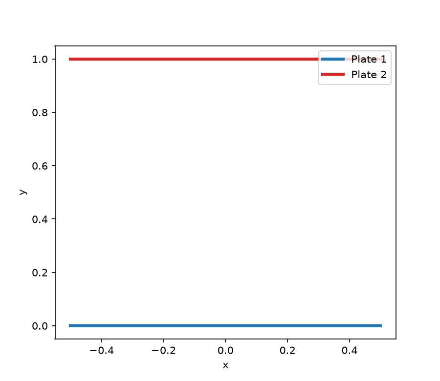

*Shown with w = 1, h = 1 (cross-section).*

Two infinitely long, directly opposed plates of width `w` separated by `h`. Reference: closed-form equation, `H = h/w`. Meshed as a 2D cross-section (per infinite depth).

| Factor | Parameters | Catalog F | Quadrature F | Quad error | MC error | Ray error |
| ------ | ---------- | --------: | -----------: | ---------: | -------: | --------: |
| 1 → 2 | w=1, h=0.25 | 0.780776 | 0.780776 | 2.8e-14% | 3.1e-04% | — |
| 1 → 2 | w=1, h=0.5 | 0.618034 | 0.618034 | 0 | 1.6e-05% | — |
| 1 → 2 | w=1, h=1.0 | 0.414214 | 0.414214 | 5.4e-14% | 2.8e-05% | — |
| 1 → 2 | w=1, h=2.0 | 0.236068 | 0.236068 | 1.2e-14% | 4.6e-05% | — |

### C-2: Infinite parallel plates, unequal width

As C-1, but with plate widths `b` and `c` separated by `a`, centrelines on a common perpendicular. Reference: closed-form equation. Same geometry builder and figure as C-1.

| Factor | Parameters | Catalog F | Quadrature F | Quad error | MC error | Ray error |
| ------ | ---------- | --------: | -----------: | ---------: | -------: | --------: |
| 1 → 2 | a=1, b=0.5, c=1.0 | 0.438447 | 0.438447 | 5.1e-14% | 1.6e-05% | — |
| 1 → 2 | a=1, b=1.0, c=2.0 | 0.684742 | 0.684742 | 4.9e-14% | 1.2e-04% | — |
| 1 → 2 | a=1, b=2.0, c=0.5 | 0.175391 | 0.175391 | 7.9e-14% | 1.6e-04% | — |

### C-3: Infinite perpendicular plates, common edge

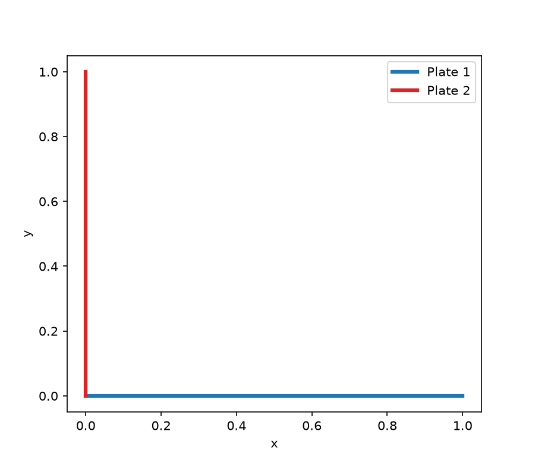

*Shown with equal widths and α = 90° (cross-section).*

Two infinitely long plates of widths `w` (A1) and `h` (A2) sharing an edge at 90°; F is A1 → A2. Reference: closed-form equation. 2D cross-section.

| Factor | Parameters | Catalog F | Quadrature F | Quad error | MC error | Ray error |
| ------ | ---------- | --------: | -----------: | ---------: | -------: | --------: |
| 1 → 2 | w=1, h=0.3 | 0.127985 | 0.127974 | 0.00799% | 0.0327% | — |
| 1 → 2 | w=1, h=0.6 | 0.216905 | 0.21696 | 0.0253% | 0.0346% | — |
| 1 → 2 | w=1, h=1.0 | 0.292893 | 0.293043 | 0.0511% | 0.0197% | — |
| 1 → 2 | w=1, h=2.0 | 0.381966 | 0.382009 | 0.0112% | 0.169% | — |

### C-4: Infinite equal plates, common edge, angle α

Two infinitely long plates of equal width sharing an edge at included angle α. Reference: closed-form equation, `F = 1 − sin(α/2)`. Same builder and figure as C-3.

| Factor | Parameters | Catalog F | Quadrature F | Quad error | MC error | Ray error |
| ------ | ---------- | --------: | -----------: | ---------: | -------: | --------: |
| 1 → 2 | w=1, α=0.524 | 0.741181 | 0.744028 | 0.384% | 0.0367% | — |
| 1 → 2 | w=1, α=1.047 | 0.5 | 0.500533 | 0.107% | 0.0539% | — |
| 1 → 2 | w=1, α=1.571 | 0.292893 | 0.293043 | 0.0511% | 0.0271% | — |
| 1 → 2 | w=1, α=2.094 | 0.133975 | 0.13402 | 0.034% | 0.011% | — |

### C-8: Infinite plane to two rows of tubes

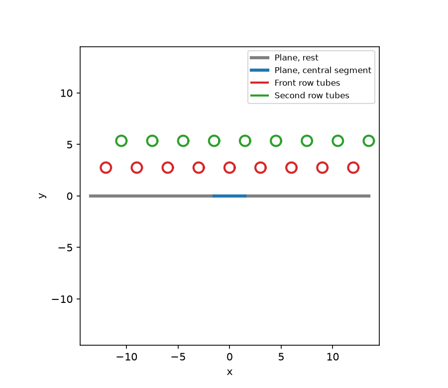

*Shown with R = 3 and 9 tubes per row; the benchmark mesh uses 31 tubes per row.*

An infinite plane facing two staggered rows of unit-diameter tubes in an equilateral triangular array, `R = p/d`. F is from a one-pitch central segment of the plane to all tubes of the front row, and to all tubes of the second row. Reference: published table. Every tube is its own obstruction group (`obstruction_groups` never applies a group to a pair involving itself, so grouping a row together would stop its tubes shadowing one another).

| Factor | Parameters | Catalog F | Quadrature F | Quad error | MC error | Ray error |
| ------ | ---------- | --------: | -----------: | ---------: | -------: | --------: |
| plane → front row of tubes | R=2.0 | 0.6576 | 0.657369 | 0.0351% | 0.036% | — |
| plane → front row of tubes | R=3.0 | 0.4675 | 0.466685 | 0.174% | 0.174% | — |
| plane → front row of tubes | R=5.0 | 0.2941 | 0.293678 | 0.144% | 0.135% | — |
| plane → second row of tubes | R=2.0 | 0.1953 | 0.202595 | 3.74% ⚠ | 3.75% ⚠ | — |
| plane → second row of tubes | R=3.0 | 0.2149 | 0.217978 | 1.43% ⚠ | 1.56% ⚠ | — |
| plane → second row of tubes | R=5.0 | 0.1824 | 0.183463 | 0.583% | 0.563% | — |

### C-10: Rectangle to semi-infinite rectangle at angle

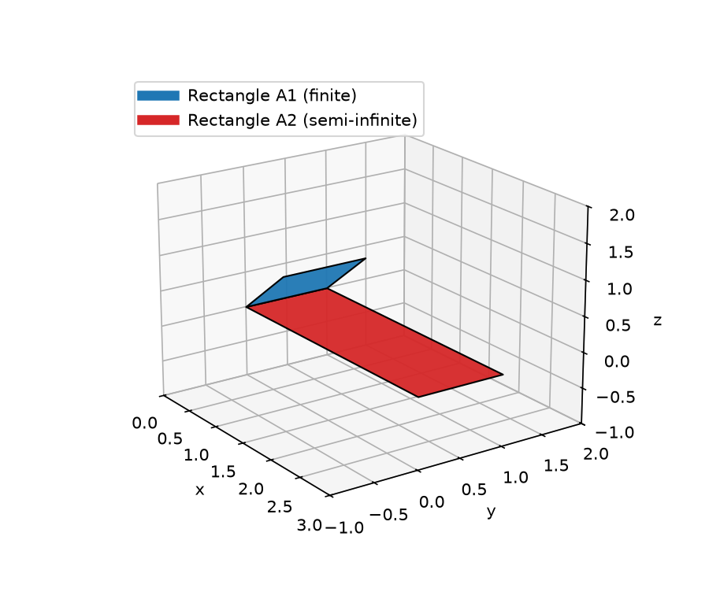

*Shown with a = b = 1, φ = 45°, and A2 truncated to width 3 for illustration; the benchmark mesh uses width 80.*

A finite rectangle A1 sharing an edge of length `b` with a second rectangle A2 at included angle φ, A2 extending to infinity away from the edge; `A = a/b`. Reference: published table. A2 is a finite rectangle of width 80 with a graded mesh (fine near the shared edge). Run with `use_duffy=true`.

| Factor | Parameters | Catalog F | Quadrature F | Quad error | MC error | Ray error |
| ------ | ---------- | --------: | -----------: | ---------: | -------: | --------: |
| 1 → 2 | A=0.4, φ=45.0° | 0.706295 | 0.729666 | 3.31% ⚠ | 3.31% ⚠ | 4.4e-04% |
| 1 → 2 | A=0.4, φ=120.0° | 0.15827 | 0.160284 | 1.27% ⚠ | 1.27% ⚠ | 0.0561% |
| 1 → 2 | A=1.0, φ=45.0° | 0.573951 | 0.580397 | 1.12% ⚠ | 1.12% ⚠ | 0.0175% |
| 1 → 2 | A=1.0, φ=120.0° | 0.110046 | 0.110503 | 0.415% | 0.416% | 0.00872% |
| 1 → 2 | A=2.0, φ=45.0° | 0.441004 | 0.443118 | 0.479% | 0.479% | 0.00985% |
| 1 → 2 | A=2.0, φ=120.0° | 0.075612 | 0.0757021 | 0.119% | 0.12% | 0.0441% |

### C-11: Identical parallel opposed rectangles

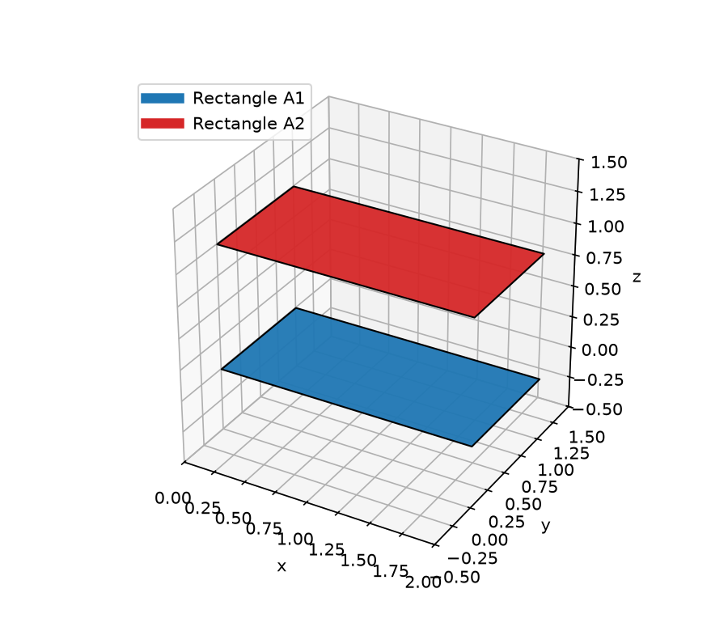

*Shown with a = 2, b = 1, c = 1.*

Two identical `a × b` rectangles in parallel planes separated by `c`. Reference: closed-form equation.

| Factor | Parameters | Catalog F | Quadrature F | Quad error | MC error | Ray error |
| ------ | ---------- | --------: | -----------: | ---------: | -------: | --------: |
| 1 → 2 | a=1.0, b=1.0, c=1.0 | 0.199825 | 0.199825 | 2.8e-13% | 2.3e-04% | 0.0123% |
| 1 → 2 | a=2.0, b=1.0, c=1.0 | 0.285875 | 0.285875 | 3.9e-13% | 4.7e-04% | 0.0407% |
| 1 → 2 | a=1.0, b=1.0, c=0.5 | 0.415253 | 0.415253 | 2.7e-13% | 0.00101% | 0.0575% |
| 1 → 2 | a=2.0, b=4.0, c=1.0 | 0.508989 | 0.508989 | 3.7e-13% | 7.7e-04% | 0.0895% |

### C-14: Perpendicular rectangles, common edge

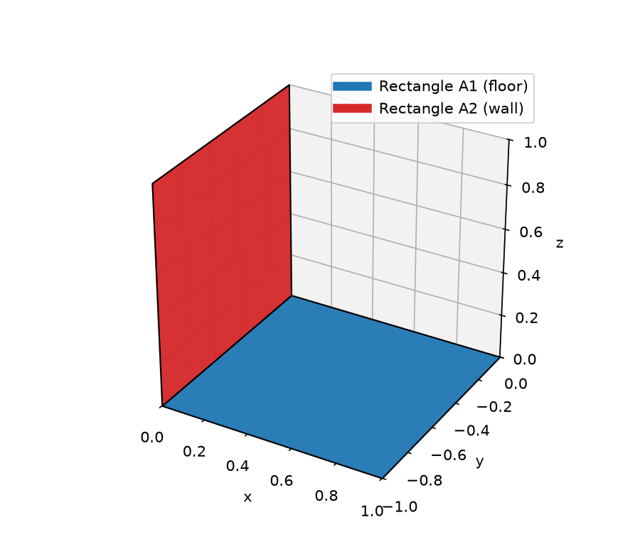

*Shown with l = w = h = 1.*

Two rectangles of common length `l` sharing an edge at 90°: A1 is `l × w`, A2 is `l × h`; F is A1 → A2. Reference: closed-form equation. Run with `use_duffy=true`.

| Factor | Parameters | Catalog F | Quadrature F | Quad error | MC error | Ray error |
| ------ | ---------- | --------: | -----------: | ---------: | -------: | --------: |
| 1 → 2 | l=1.0, w=1.0, h=1.0 | 0.200044 | 0.200089 | 0.0227% | 0.0251% | 0.142% |
| 1 → 2 | l=1.0, w=2.0, h=1.0 | 0.116426 | 0.116438 | 0.0103% | 0.00742% | 0.232% |
| 1 → 2 | l=1.0, w=1.0, h=0.5 | 0.146187 | 0.146204 | 0.0117% | 0.0112% | 0.0155% |
| 1 → 2 | l=2.0, w=1.0, h=1.0 | 0.240636 | 0.240648 | 0.00503% | 0.00633% | 0.278% |

### C-33: Hexagonal prism

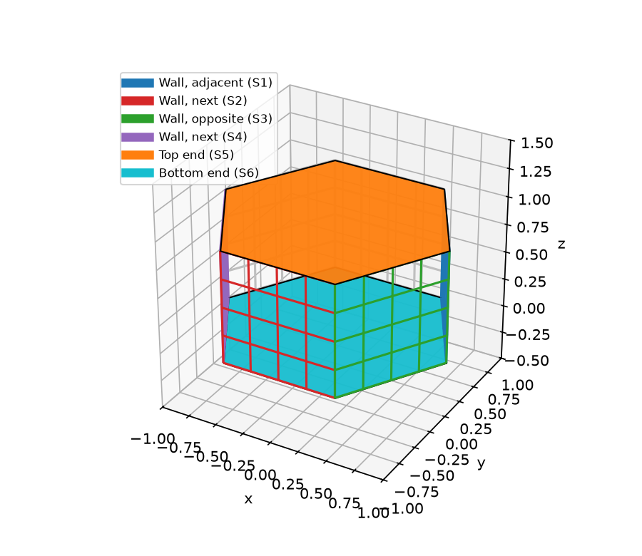

*Shown with l = h = 1.*

Interior of a hexagonal prism with side `l` and height `h`, `L = l/h`. Six factors per point: wall to adjacent, next, and opposite wall, end to wall, wall to end, and end to end. Reference: published table. Run with `reverse_normals=true`, `use_duffy=true`, and `radiating_groups` set to the groups each factor reads.

| Factor | Parameters | Catalog F | Quadrature F | Quad error | MC error | Ray error |
| ------ | ---------- | --------: | -----------: | ---------: | -------: | --------: |
| wall→adjacent wall | L=0.5 | 0.10656 | 0.106586 | 0.0243% | 0.0236% | 0.0112% |
| wall→next wall | L=0.5 | 0.137152 | 0.137152 | 1.3e-04% | 0.00194% | 0.127% |
| wall→opposite wall | L=0.5 | 0.144201 | 0.144201 | 3.1e-04% | 0.00128% | 0.235% |
| end→wall | L=0.5 | 0.141787 | 0.141814 | 0.0188% | 0.0186% | 0.027% |
| wall→end | L=0.5 | 0.184187 | 0.184221 | 0.0186% | 0.0194% | 0.368% |
| end→end | L=0.5 | 0.149277 | 0.149275 | 0.00135% | 9.8e-04% | 0.111% |
| wall→adjacent wall | L=1.0 | 0.086615 | 0.0866408 | 0.0297% | 0.0323% | 0.0261% |
| wall→next wall | L=1.0 | 0.086763 | 0.087511 | 0.862% | 0.862% | 1.23% ⚠ |
| wall→opposite wall | L=1.0 | 0.087598 | 0.0875981 | 1.7e-04% | 0.00336% | 0.0166% |
| end→wall | L=1.0 | 0.108358 | 0.108602 | 0.225% | 0.227% | 0.189% |
| wall→end | L=1.0 | 0.282823 | 0.282156 | 0.236% | 0.234% | 0.264% |
| end→end | L=1.0 | 0.34685 | 0.348576 | 0.498% | 0.499% | 0.65% |
| wall→adjacent wall | L=2.0 | 0.063248 | 0.0632604 | 0.0197% | 0.0225% | 0.296% |
| wall→next wall | L=2.0 | 0.048166 | 0.0481668 | 0.00157% | 2.0e-04% | 0.0343% |
| wall→opposite wall | L=2.0 | 0.046892 | 0.0468919 | 2.2e-04% | 0.00141% | 0.345% |
| end→wall | L=2.0 | 0.070271 | 0.0702842 | 0.0188% | 0.0204% | 0.0809% |
| wall→end | L=2.0 | 0.36514 | 0.365207 | 0.0184% | 0.0194% | 0.0463% |
| end→end | L=2.0 | 0.578372 | 0.578373 | 2.2e-04% | 5.6e-04% | 0.0361% |

### C-34: Parallel regular polygons

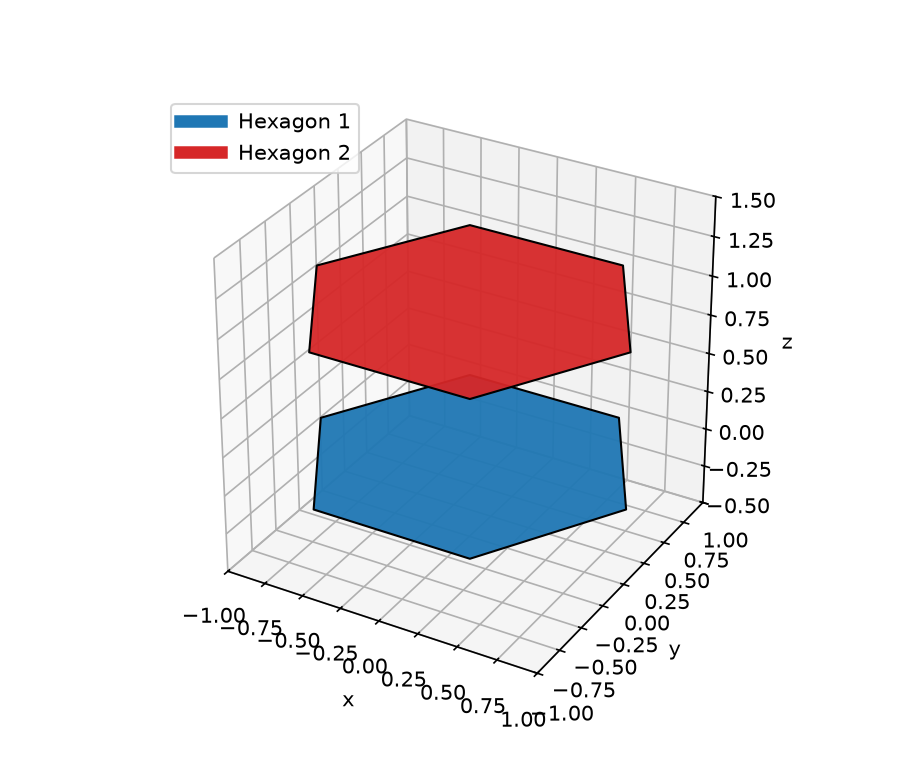

*Shown with n = 6, l = h = 1.*

Two identical, aligned regular n-gons of side `l` in parallel planes separated by `h`, `L = l/h`, for n = 3, 4, 5, 6, 8. Reference: published table.

| Factor | Parameters | Catalog F | Quadrature F | Quad error | MC error | Ray error |
| ------ | ---------- | --------: | -----------: | ---------: | -------: | --------: |
| 1 → 2 | n=3, L=0.4 | 0.020953 | 0.0209551 | 0.0102% | 0.00971% | 0.407% |
| 1 → 2 | n=4, L=0.4 | 0.046137 | 0.0461374 | 9.0e-04% | 1.5e-04% | 0.225% |
| 1 → 2 | n=5, L=0.4 | 0.074812 | 0.0748117 | 3.4e-04% | 0.00226% | 0.0271% |
| 1 → 2 | n=6, L=0.4 | 0.105661 | 0.10566 | 8.5e-04% | 7.0e-04% | 0.0518% |
| 1 → 2 | n=8, L=0.4 | 0.169516 | 0.169481 | 0.0207% | 0.0206% | 0.0413% |
| 1 → 2 | n=3, L=1.0 | 0.105604 | 0.105606 | 0.00173% | 7.2e-04% | 0.0848% |
| 1 → 2 | n=4, L=1.0 | 0.199825 | 0.199825 | 5.2e-05% | 2.3e-05% | 0.0133% |
| 1 → 2 | n=5, L=1.0 | 0.280465 | 0.280463 | 5.6e-04% | 9.5e-04% | 0.116% |
| 1 → 2 | n=6, L=1.0 | 0.346849 | 0.348576 | 0.498% | 0.5% | 0.47% |
| 1 → 2 | n=8, L=1.0 | 0.455024 | 0.455013 | 0.0024% | 0.0018% | 0.0401% |
| 1 → 2 | n=3, L=2.0 | 0.26656 | 0.266561 | 4.6e-04% | 0.00291% | 0.0512% |
| 1 → 2 | n=4, L=2.0 | 0.415253 | 0.415253 | 6.8e-05% | 7.1e-04% | 0.0211% |
| 1 → 2 | n=5, L=2.0 | 0.510751 | 0.510752 | 1.1e-04% | 5.5e-04% | 0.0104% |
| 1 → 2 | n=6, L=2.0 | 0.578372 | 0.578373 | 2.2e-04% | 0.00111% | 6.8e-04% |
| 1 → 2 | n=8, L=2.0 | 0.668802 | 0.668799 | 3.9e-04% | 0.00214% | 0.0153% |

### C-40: Coaxial parallel disks, equal radius

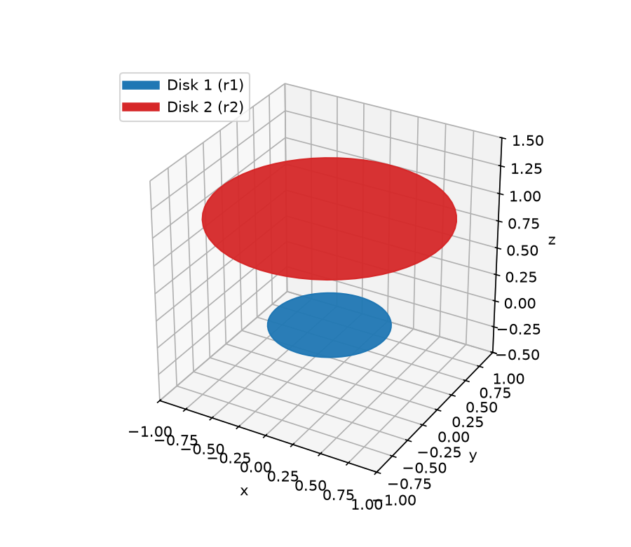

*Shown with r1 = 0.5, r2 = 1, separation 1.*

Two coaxial parallel disks of equal radius `r` separated by `a`. Reference: closed-form equation (C-41 with `r1 = r2`).

| Factor | Parameters | Catalog F | Quadrature F | Quad error | MC error | Ray error |
| ------ | ---------- | --------: | -----------: | ---------: | -------: | --------: |
| 1 → 2 | r=0.5, a=0.5 | 0.381966 | 0.381966 | 2.0e-05% | 0.00159% | 0.159% |
| 1 → 2 | r=0.5, a=1.0 | 0.171573 | 0.171573 | 3.1e-05% | 5.2e-04% | 0.255% |
| 1 → 2 | r=0.5, a=2.0 | 0.0557281 | 0.0557281 | 4.0e-05% | 0.00203% | 0.26% |

### C-41: Coaxial parallel disks, unequal radius

Coaxial parallel disks of radii `r1` and `r2` separated by `a`; F is disk 1 → disk 2. Reference: closed-form equation. Same builder and figure as C-40.

| Factor | Parameters | Catalog F | Quadrature F | Quad error | MC error | Ray error |
| ------ | ---------- | --------: | -----------: | ---------: | -------: | --------: |
| 1 → 2 | r1=0.5, r2=0.75, a=1.5 | 0.186513 | 0.186513 | 5.0e-06% | 2.3e-04% | 0.217% |
| 1 → 2 | r1=0.5, r2=1.0, a=1.0 | 0.468871 | 0.468871 | 1.2e-06% | 5.6e-04% | 0.167% |
| 1 → 2 | r1=1.0, r2=0.5, a=1.0 | 0.117218 | 0.117218 | 4.0e-05% | 5.1e-05% | 0.185% |

### C-63: Concentric infinite cylinders

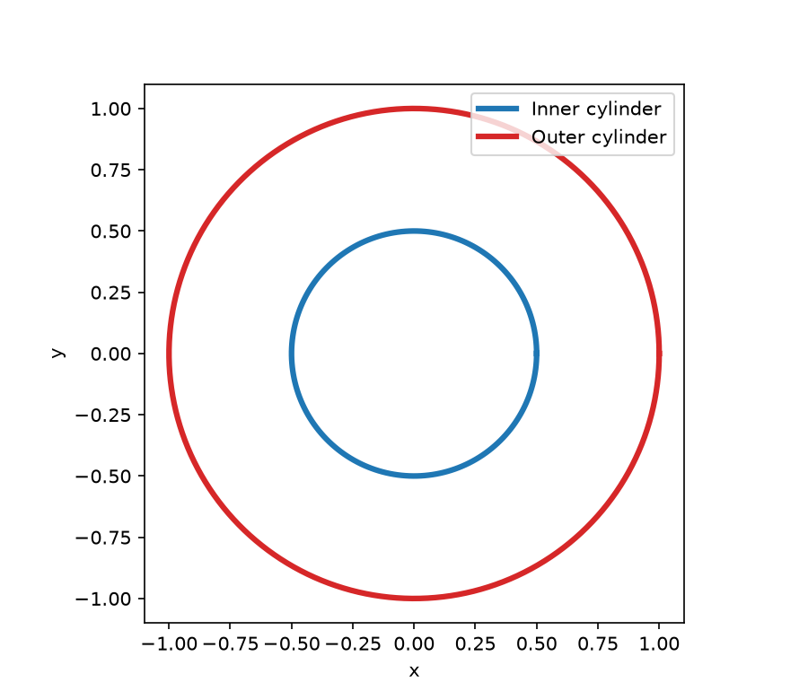

*Shown with r1 = 0.5, r2 = 1 (cross-section).*

Infinitely long concentric cylinders; F is outer → inner, `F = D1/D2`. Reference: closed-form equation. 2D cross-section.

| Factor | Parameters | Catalog F | Quadrature F | Quad error | MC error | Ray error |
| ------ | ---------- | --------: | -----------: | ---------: | -------: | --------: |
| outer → inner | r1=0.5, r2=0.75 | 0.666667 | 0.66667 | 4.3e-04% | 3.0e-04% | — |
| outer → inner | r1=0.5, r2=1.0 | 0.5 | 0.500001 | 1.9e-04% | 2.1e-04% | — |
| outer → inner | r1=0.5, r2=2.0 | 0.25 | 0.249997 | 0.00107% | 5.6e-05% | — |

### C-68: Infinite parallel cylinders, equal diameter

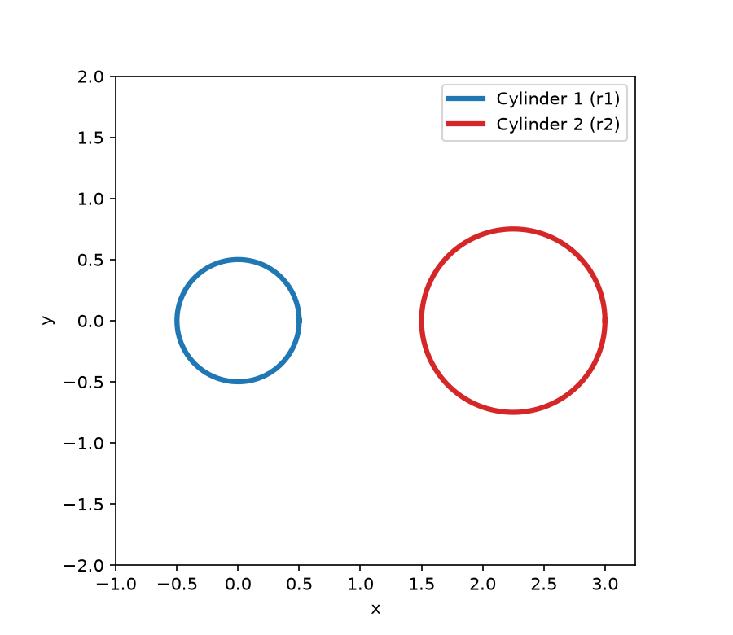

*Shown with r1 = 0.5, r2 = 0.75, s = 1 (cross-section).*

Two infinitely long parallel cylinders of radius `r` with surface-to-surface gap `s` (not axis-to-axis). Reference: closed-form equation. 2D cross-section, `reverse_normals=true`.

| Factor | Parameters | Catalog F | Quadrature F | Quad error | MC error | Ray error |
| ------ | ---------- | --------: | -----------: | ---------: | -------: | --------: |
| 1 → 2 | r=0.5, s=0.5 | 0.110696 | 0.110696 | 1.2e-04% | 0.00561% | — |
| 1 → 2 | r=0.5, s=1.0 | 0.0813758 | 0.0813758 | 5.5e-06% | 0.00165% | — |
| 1 → 2 | r=0.5, s=2.0 | 0.0535601 | 0.0535601 | 3.9e-05% | 0.00111% | — |
| 1 → 2 | r=0.5, s=4.0 | 0.0319384 | 0.0319384 | 4.7e-05% | 8.4e-04% | — |

### C-69: Infinite parallel cylinders, unequal radius

As C-68 with radii `r1` and `r2`; `s` is again the surface-to-surface gap. F is cylinder 1 → 2. Reference: closed-form equation. Same builder and figure as C-68.

| Factor | Parameters | Catalog F | Quadrature F | Quad error | MC error | Ray error |
| ------ | ---------- | --------: | -----------: | ---------: | -------: | --------: |
| 1 → 2 | r1=0.5, r2=0.75, s=1.0 | 0.109248 | 0.109248 | 4.6e-06% | 0.00275% | — |
| 1 → 2 | r1=0.5, r2=1.5, s=0.5 | 0.20747 | 0.20747 | 8.5e-05% | 0.00145% | — |
| 1 → 2 | r1=1.0, r2=0.25, s=2.0 | 0.0249173 | 0.0249173 | 9.3e-05% | 0.00363% | — |

### C-72: Cylinder in square array

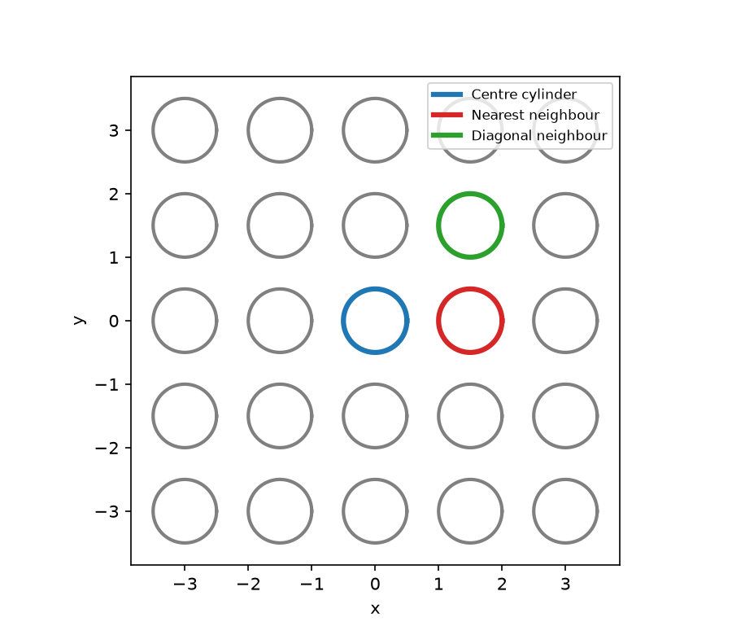

*Square array shown with P = 1.5 (cross-section).*

A centre cylinder in an infinite square array of cylinders, `P = p/d`; F is from the centre cylinder to its nearest and diagonal neighbours. Reference: published table. Modelled as a 5 × 5 array, each cylinder its own obstruction group, with `radiating_groups=[1,2,3]`.

| Factor | Parameters | Catalog F | Quadrature F | Quad error | MC error | Ray error |
| ------ | ---------- | --------: | -----------: | ---------: | -------: | --------: |
| nearest neighbour | P=1.2 | 0.14274 | 0.142741 | 7.5e-04% | 0.00306% | — |
| diagonal neighbour | P=1.2 | 0.0876 | 0.0876186 | 0.0213% | 0.0613% | — |
| nearest neighbour | P=1.5 | 0.1107 | 0.110696 | 0.00372% | 0.0172% | — |
| diagonal neighbour | P=1.5 | 0.07652 | 0.0765189 | 0.00143% | 0.00481% | — |
| nearest neighbour | P=2.0 | 0.08138 | 0.0813757 | 0.00525% | 0.00302% | — |
| diagonal neighbour | P=2.0 | 0.05688 | 0.0568792 | 0.00139% | 0.00241% | — |

### C-73: Cylinder in triangular array

As C-72 for an equilateral triangular array; F is to the nearest and next neighbour. Reference: published table. Same builder as C-72 (the figure shows the square variant).

| Factor | Parameters | Catalog F | Quadrature F | Quad error | MC error | Ray error |
| ------ | ---------- | --------: | -----------: | ---------: | -------: | --------: |
| nearest neighbour | P=1.2 | 0.14274 | 0.142741 | 7.5e-04% | 0.00862% | — |
| next neighbour | P=1.2 | 0.02367 | 0.0239399 | 1.14% ⚠ | 0.395% | — |
| nearest neighbour | P=1.5 | 0.1107 | 0.110696 | 0.00372% | 0.00796% | — |
| next neighbour | P=1.5 | 0.04606 | 0.0461575 | 0.212% | 0.108% | — |
| nearest neighbour | P=2.0 | 0.08138 | 0.0813757 | 0.00525% | 0.00523% | — |
| next neighbour | P=2.0 | 0.04627 | 0.0462714 | 0.00304% | 0.0027% | — |

### C-79: Cylinder base to inside lateral surface

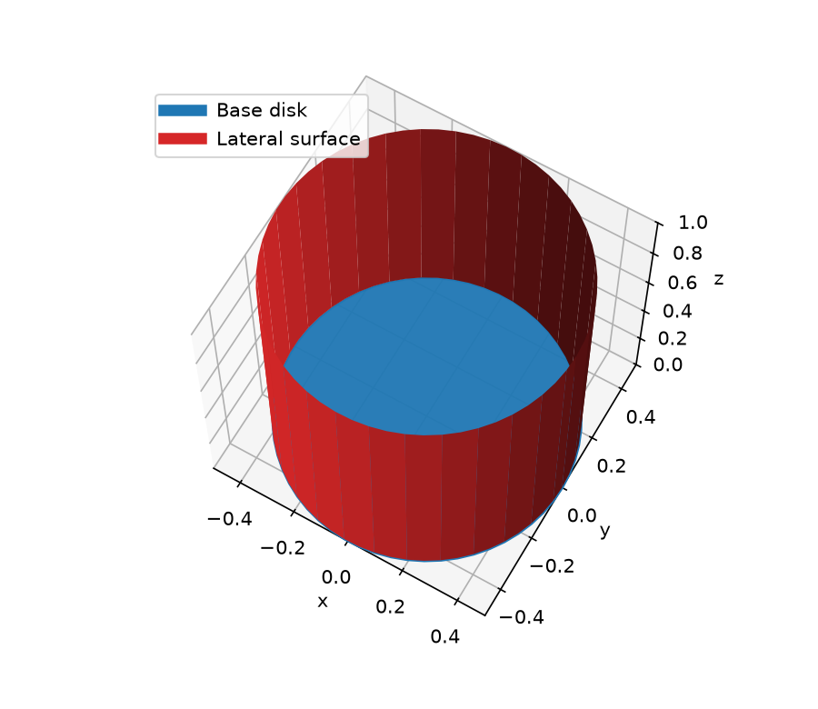

*Shown with r = 0.5, h = 1.*

Base of a right circular cylinder of radius `r` and height `h` to its inside lateral surface. Reference: closed-form equation. Run with `reverse_normals=true`, `use_duffy=true`.

| Factor | Parameters | Catalog F | Quadrature F | Quad error | MC error | Ray error |
| ------ | ---------- | --------: | -----------: | ---------: | -------: | --------: |
| 1 → 2 | r=0.5, h=0.5 | 0.618034 | 0.618162 | 0.0207% | 0.0223% | 0.71% |
| 1 → 2 | r=0.5, h=1.0 | 0.828427 | 0.828549 | 0.0147% | 0.0153% | 0.806% |
| 1 → 2 | r=0.5, h=2.0 | 0.944272 | 0.944408 | 0.0144% | 0.0146% | 0.849% |

### C-109: Cone interior to base

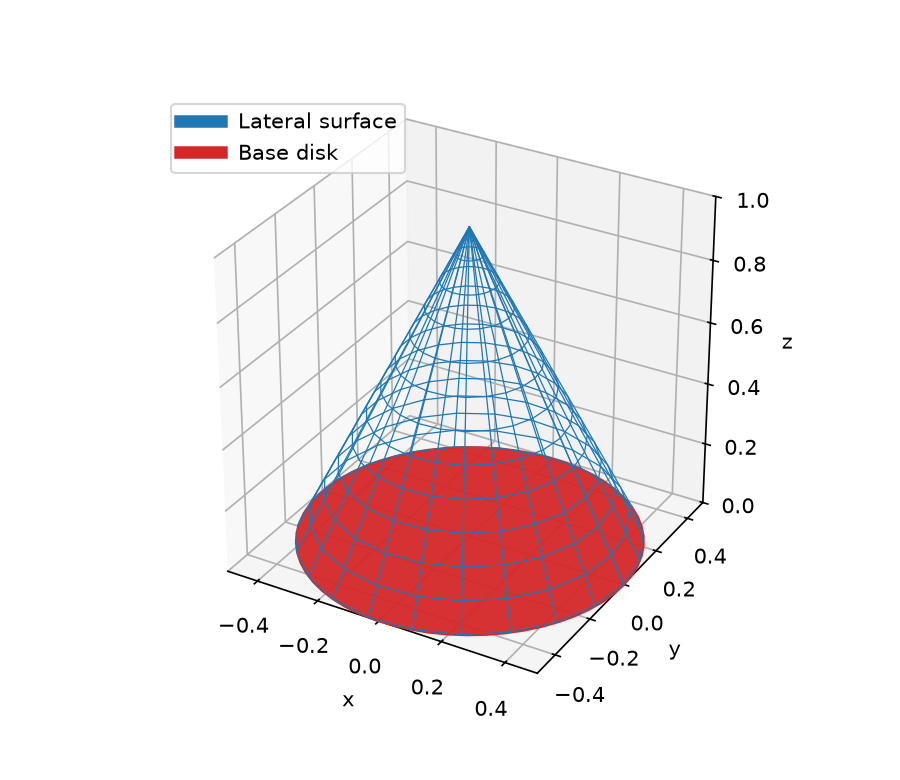

*Shown with r = 0.5, h = 1.*

Interior lateral surface of a right circular cone to its base, `F = 1/√(1 + (h/r)²)`. Reference: closed-form equation. Run with `reverse_normals=true`, `use_duffy=true`. Must be meshed with quads (see [Limitations found by the suite](@ref)).

| Factor | Parameters | Catalog F | Quadrature F | Quad error | MC error | Ray error |
| ------ | ---------- | --------: | -----------: | ---------: | -------: | --------: |
| 1 → 2 | r=0.5, h=0.5 | 0.707107 | 0.708562 | 0.206% | 0.205% | 0.431% |
| 1 → 2 | r=0.5, h=1.0 | 0.447214 | 0.448191 | 0.218% | 0.218% | 0.546% |
| 1 → 2 | r=0.5, h=2.0 | 0.242536 | 0.24283 | 0.121% | 0.121% | 0.684% |

### C-125: Sphere to coaxial disk

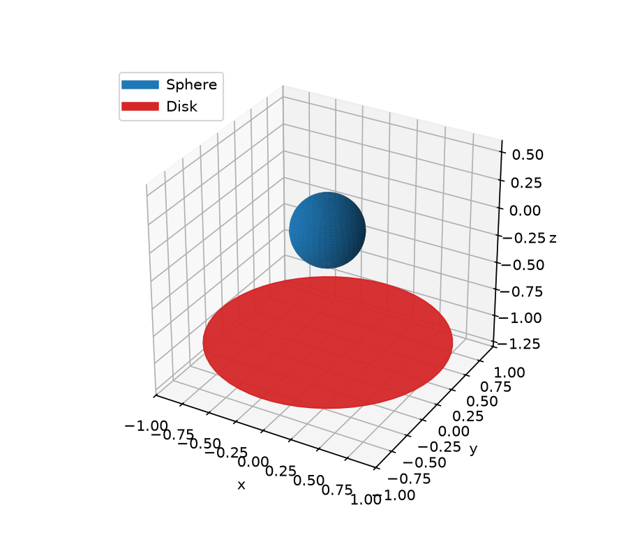

*Shown with rs = 0.3, r = 1, a = 1.*

Sphere of radius `rs` to a coaxial disk of radius `r` whose plane lies `a` from the sphere centre. Reference: closed-form equation (independent of `rs`).

| Factor | Parameters | Catalog F | Quadrature F | Quad error | MC error | Ray error |
| ------ | ---------- | --------: | -----------: | ---------: | -------: | --------: |
| 1 → 2 | rs=0.3, r=0.25, a=1 | 0.0149287 | 0.014928 | 0.00477% | 0.00829% | 1.66% ⚠ |
| 1 → 2 | rs=0.3, r=0.5, a=1 | 0.0527864 | 0.0527873 | 0.00179% | 4.4e-04% | 1.85% ⚠ |
| 1 → 2 | rs=0.3, r=1.0, a=1 | 0.146447 | 0.146449 | 0.00166% | 0.00248% | 1.42% ⚠ |
| 1 → 2 | rs=0.3, r=2.0, a=1 | 0.276393 | 0.276396 | 0.0011% | 2.9e-04% | 1.43% ⚠ |

### C-135: Concentric spheres

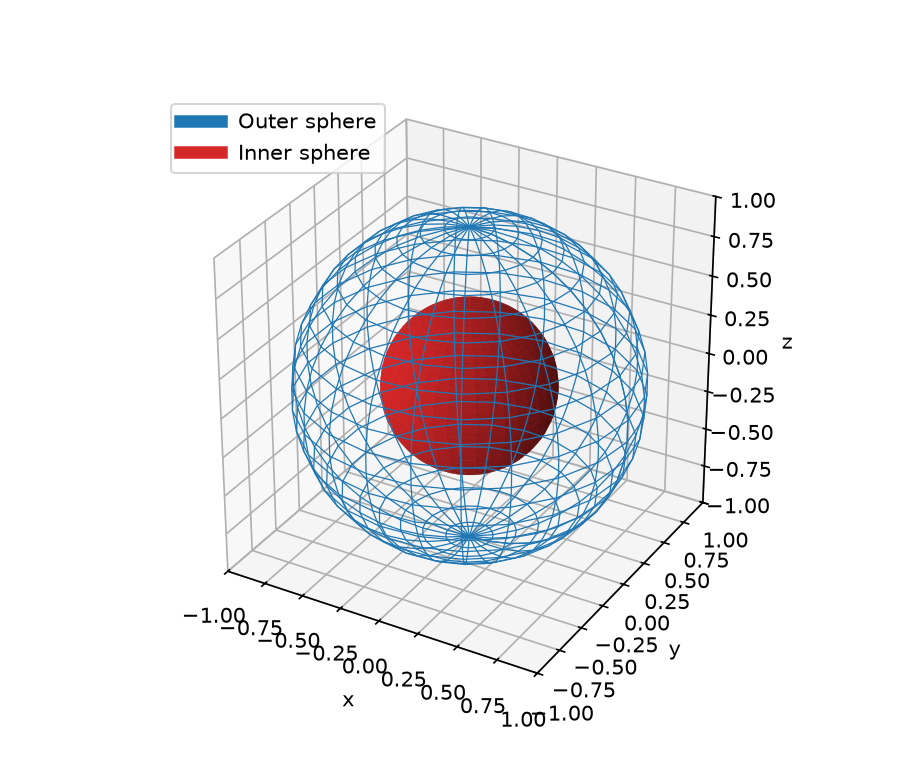

*Shown with r1 = 0.5, r2 = 1.*

Concentric spheres; F is outer → inner, `F = (r1/r2)²`. Reference: closed-form equation. Only the outer sphere's normals are reversed (`reverse_group_normals`), since the boolean cut already leaves the inner sphere outward-facing.

| Factor | Parameters | Catalog F | Quadrature F | Quad error | MC error | Ray error |
| ------ | ---------- | --------: | -----------: | ---------: | -------: | --------: |
| outer → inner | r1=0.5, r2=0.75 | 0.444444 | 0.44435 | 0.0212% | 0.0211% | 2.84% ⚠ |
| outer → inner | r1=0.5, r2=1.0 | 0.25 | 0.249937 | 0.0253% | 0.0252% | 2.19% ⚠ |
| outer → inner | r1=0.5, r2=2.0 | 0.0625 | 0.0624832 | 0.0268% | 0.0272% | 1.65% ⚠ |

### C-137: Two spheres of unequal radius

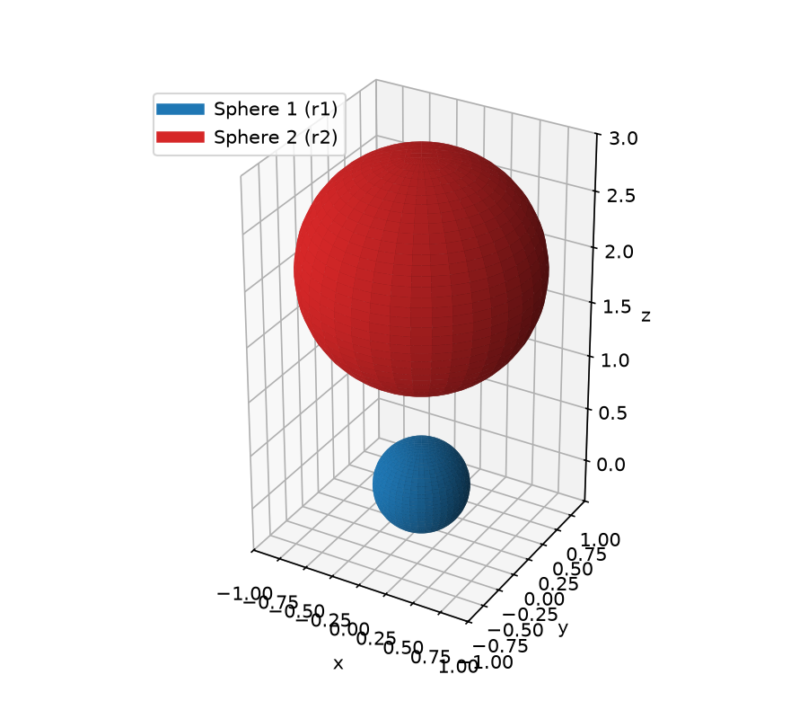

*Shown with r1 = 0.4, r2 = 1, s = 0.6.*

Two spheres of radii `r1` and `r2` with surface-to-surface gap `s`, `R = r1/r2`, `S = s/r2`; F is sphere 1 → 2. Reference: published table (3 significant figures).

| Factor | Parameters | Catalog F | Quadrature F | Quad error | MC error | Ray error |
| ------ | ---------- | --------: | -----------: | ---------: | -------: | --------: |
| 1 → 2 | R=0.4, S=0.2 | 0.114 | 0.113249 | 0.658% | 0.658% | 1.88% ⚠ |
| 1 → 2 | R=0.4, S=1.0 | 0.0459 | 0.0458807 | 0.042% | 0.0409% | 1.54% ⚠ |
| 1 → 2 | R=1.0, S=0.2 | 0.0595 | 0.0593139 | 0.313% | 0.312% | 2.55% ⚠ |
| 1 → 2 | R=1.0, S=1.0 | 0.0294 | 0.029587 | 0.636% | 0.635% | 1.43% ⚠ |
| 1 → 2 | R=3.0, S=0.2 | 0.0174 | 0.0173644 | 0.205% | 0.206% | 1.45% ⚠ |
| 1 → 2 | R=3.0, S=1.0 | 0.0113 | 0.0113165 | 0.146% | 0.147% | 0.945% |

## Limitations found by the suite

- **Shared-edge singularity.** Surfaces that share an edge (C-3, C-4, C-10, C-14, C-33, C-79, C-109) are the least accurate. `use_duffy=true` is what makes them usable: it takes C-14 from 3.5% to 0.023% error. C-10 at A = 0.4 converges, but slowly, and the benchmark uses a moderate mesh.
- **Duffy is quad-only.** It silently skips triangles. C-109 meshed with quads gives 0.2% error; the same geometry meshed with triangles gives 3.6–9.2%. Mesh edge-sharing geometries with quads.
- **Obstruction accuracy is set by facet count.** Obstruction soups use only element corner nodes, so a curved blocker is an inscribed polygon. This is the source of C-8's second-row error (0.6–3.7%), which converges as tube facets are refined.
- **Ray-shooting bias on coarse curved meshes.** Its worst points are on spheres (C-125, C-135, C-137). The error does not shrink with `n_rays` but does shrink with mesh refinement (C-135: 2.8% → 1.0% → 0.4% as element size halves twice), so it is a faceting effect, not sampling noise.

## Cases not included

C-35 and C-154 were attempted and excluded: their published figures are ambiguous about which surface is meant, and no reading tried reproduced the table (errors of 39–83%, and two readings gave a self view factor above 1). C-13c (no geometry definition on the catalog page) and C-101 (needs raster equations as well as a table) were set aside. Most of the remaining entries carry an equation that must be transcribed by hand and a bespoke geometry; C-156 to C-162 (people and animals) have no meaningful mesh.

## Recorded run

| | Quadrature and pair-area MC | Ray-shooting MC |
| --- | --- | --- |
| Date | 2026-09-14 | 2026-09-15 |
| Commit | `1a8508f` (dirty tree) | `272bed9` (dirty tree) |
| Machine | Apple M3, 16 GB, 8 Julia threads | Apple M3, 16 GB, 4 Julia threads |
| Julia | 1.12.7 | 1.12.7 |
| Wall time | 6306 s | 198 s |

Raw results, one row per point per kernel, are in `benchmarks/howell/results.csv`.
